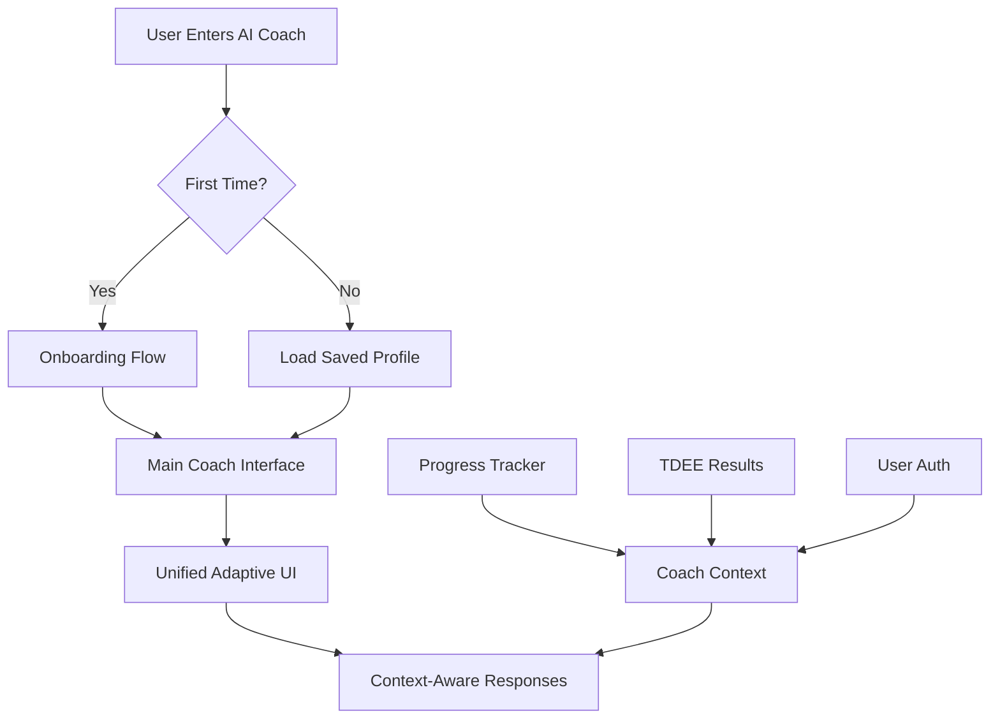

# AI Coach 2.0 - Complete Redesign Plan

## 📋 Executive Summary

We're transforming the current Q&A-style AI coach into a comprehensive, personalized fitness coaching system with memory, progress tracking, and proactive engagement.

## 🚫 Current System (Being Replaced)

### Problems with Current Approach:
- **Dual-mode confusion**: Card view vs Chat view showing same content
- **No memory**: Each conversation starts fresh
- **Just Q&A**: Basically ChatGPT with fitness focus
- **No accountability**: Doesn't track if users follow advice
- **TDEE forced context**: Always includes TDEE even when irrelevant

### Current Files to Refactor:
```
/src/components/ai/
  ├── AICoachInterface.tsx (1400+ lines, dual mode confusion)
  ├── ChatInterface.tsx (454 lines, redundant with cards)
  ├── CoachingModeSelector.tsx (373 lines, keep but enhance)
  └── AIResponseFormatter.tsx (299 lines, needs complete redesign)

/src/lib/
  ├── aiCoaching.ts (800+ lines, needs restructuring)
  ├── contextAnalyzer.ts (400+ lines, keep and enhance)
  └── aiService.ts (needs token limit increases)
```

## ✨ New System Design

### Core Architecture



### 1. Authentication & Data Persistence

```typescript
interface UserProfile {
  // Authentication
  authId: string; // From Google/Facebook OAuth
  email: string;
  name: string;
  
  // Onboarding Data
  onboardingComplete: boolean;
  coachSetup: {
    goals: 'fat-loss' | 'muscle-gain' | 'fitness' | 'performance' | 'health';
    timeline: 'no-rush' | '3-months' | '6-weeks';
    struggles: string[];
    coachingStyle: 'supportive' | 'reality-check' | 'analytical' | 'socratic';
    checkInFrequency: 'daily' | '3x-week' | 'weekly';
    useTDEEData: boolean;
    restrictions: string[];
  };
  
  // Saved TDEE Results
  tdeeHistory: TDEEResult[];
  currentTDEE: TDEEResult;
  
  // Progress Data (linked to Progress Tracker)
  progressData: {
    weight: WeightEntry[];
    measurements: MeasurementEntry[];
    workouts: WorkoutLog[];
    nutrition: NutritionLog[];
    adherence: AdherenceData[];
  };
  
  // Coach Memory
  coachMemory: {
    conversations: ConversationHistory[];
    commitments: Commitment[];
    insights: GeneratedInsight[];
    lastCheckIn: Date;
  };
}
```

## 🎯 Onboarding Flow (New Component)

### Screen Flow:

#### Welcome Screen
```typescript
// /src/components/coach/CoachOnboarding.tsx
interface OnboardingStep1 {
  message: "Welcome! I'm your AI fitness coach. Let's personalize your experience.";
  action: "What should I call you?";
  input: text_field; // Store as user.name
}
```

#### Goals & Timeline (Screen 2)
```typescript
interface OnboardingStep2 {
  primaryGoal: {
    title: "What's your main goal?";
    options: [
      "🔥 Lose fat while keeping muscle",
      "💪 Build muscle and strength",
      "🏃 Improve general fitness",
      "⚡ Sports performance",
      "❤️ Health & longevity"
    ];
  };
  timeline: {
    title: "What's your timeline?";
    options: [
      "♻️ No rush - sustainable progress",
      "📅 3 months - moderate pace",
      "🎯 6 weeks - aggressive"
    ];
  };
}
```

#### Struggles & Support (Screen 3)
```typescript
interface OnboardingStep3 {
  struggles: {
    title: "What's been your biggest challenge?";
    options: [
      "Can't stick to diet",
      "No workout motivation",
      "Information overload",
      "Time constraints",
      "Hit a plateau",
      "Don't know where to start"
    ];
    maxSelect: 2;
  };
  supportLevel: {
    title: "How often should I check in?";
    options: [
      "Daily (high accountability)",
      "3x per week (balanced)",
      "Weekly (independent)"
    ];
  };
}
```

#### Coaching Style & Data (Screen 4)
```typescript
interface OnboardingStep4 {
  coachingStyle: {
    title: "How should I coach you?";
    options: [
      "🤗 Supportive - Encouraging and motivational",
      "🎯 Reality Check - Direct and no-nonsense",
      "📊 Analytical - Data-driven insights",
      "🧠 Socratic - Guide through questions"
    ];
  };
  dataUsage: {
    title: "Connect your data?";
    options: [
      "Use my TDEE results for personalization",
      "Connect progress tracker data",
      "Keep coaching general (no personal data)"
    ];
  };
}
```

#### Quick Preferences (Final Screen)
```typescript
interface OnboardingStep5 {
  restrictions: {
    title: "Any limitations I should know?";
    options: [
      "🌱 Vegetarian/Vegan",
      "🏠 Home workouts only",
      "🤕 Injury/limitations",
      "⏰ <30 min/day available",
      "None of these"
    ];
  };
  confirmation: {
    message: "Perfect, {name}! I've customized your coaching experience.";
    action: "Start Coaching →";
  };
}
```

## 🖥️ Main Coach Interface (Unified Design)

### New Component Structure:
```
/src/components/coach/
  ├── CoachDashboard.tsx       // Main container
  ├── CoachOnboarding.tsx       // Onboarding flow
  ├── ProgressSummary.tsx       // Top progress card
  ├── DailyFocus.tsx           // Today's targets
  ├── CoachConversation.tsx    // Message interface
  ├── QuickActions.tsx         // Action buttons
  └── CoachSettings.tsx        // Preferences
```

### Interface Layout:

```typescript
// /src/components/coach/CoachDashboard.tsx
interface CoachDashboard {
  header: {
    greeting: "Good morning, {name}!";
    date: "Week 2 of your journey";
    settingsIcon: link_to_preferences;
  };
  
  sections: {
    // 1. Progress Summary (Pulls from Progress Tracker)
    progressCard: {
      weekNumber: 2;
      adherenceRate: 85;
      weightChange: -1.5;
      streakDays: 7;
      nextCheckIn: "Tomorrow";
    };
    
    // 2. Today's Focus
    dailyFocus: {
      workout: "Back & Biceps" | "Rest Day";
      nutritionTarget: "150g protein, 2200 calories";
      waterGoal: "3L";
      customReminder?: "Pre-workout meal 1hr before";
    };
    
    // 3. Coach Messages (Adaptive based on context)
    conversation: {
      proactiveMessage: string; // Based on time/progress
      userInput: text_field;
      responseArea: adaptive_layout; // Cards, lists, or chat based on content
    };
    
    // 4. Quick Actions
    quickActions: [
      "Log Today's Weight",
      "Complete Workout",
      "Food Diary",
      "Ask Question"
    ];
  };
}
```

## 🧠 Smart Response System

### Content-Aware Formatting:

```typescript
// /src/lib/coachResponseFormatter.ts
interface ResponseFormatter {
  analyzeContent(response: string): ContentType;
  
  formatters: {
    'workout-plan': () => ExerciseCard[];
    'meal-plan': () => NutritionTable;
    'progress-analysis': () => ChartWithInsights;
    'education': () => ArticleCard;
    'check-in': () => ChecklistCard;
    'motivation': () => QuoteCard;
    'data-points': () => StatsGrid;
    'default': () => ChatBubble;
  };
}
```

## 🔄 Integration Points

### 1. TDEE Calculator Integration
```typescript
// When user completes TDEE calculation
afterTDEECalculation() {
  if (user.authenticated) {
    saveTDEEResult(result);
    if (coachEnabled) {
      notifyCoach('New TDEE data available');
      updateCoachingPlan(result);
    }
  } else {
    promptAuthentication('Save your results and get personalized coaching?');
  }
}
```

### 2. Progress Tracker Integration
```typescript
// Bidirectional sync
progressTracker.onUpdate = (data) => {
  coach.updateContext(data);
  coach.generateInsight(data);
};

coach.onCommitment = (commitment) => {
  progressTracker.addGoal(commitment);
};
```

### 3. Authentication Flow
```typescript
// OAuth setup
authProviders: {
  google: GoogleAuthProvider;
  facebook: FacebookAuthProvider;
  anonymous: LocalStorageOnly; // Current behavior
}

// Data migration
onFirstAuth(user) {
  migrateLocalStorage(user);
  mergeTDEEHistory(user);
  startOnboarding(user);
}
```

## 📊 Database Schema (New)

```sql
-- Users table (Firebase Auth integration)
users {
  id: uuid PRIMARY KEY,
  auth_id: string UNIQUE,
  email: string,
  name: string,
  created_at: timestamp,
  onboarding_completed: boolean
}

-- Coach profiles
coach_profiles {
  user_id: uuid REFERENCES users,
  goals: jsonb,
  coaching_style: string,
  check_in_frequency: string,
  preferences: jsonb,
  created_at: timestamp
}

-- TDEE results
tdee_results {
  id: uuid PRIMARY KEY,
  user_id: uuid REFERENCES users,
  result_data: jsonb,
  created_at: timestamp
}

-- Progress entries
progress_entries {
  id: uuid PRIMARY KEY,
  user_id: uuid REFERENCES users,
  entry_type: string, -- weight, measurement, workout, nutrition
  entry_data: jsonb,
  created_at: timestamp
}

-- Coach conversations
coach_conversations {
  id: uuid PRIMARY KEY,
  user_id: uuid REFERENCES users,
  messages: jsonb[],
  context: jsonb,
  created_at: timestamp
}

-- Commitments tracking
commitments {
  id: uuid PRIMARY KEY,
  user_id: uuid REFERENCES users,
  commitment_text: string,
  due_date: date,
  completed: boolean,
  created_at: timestamp
}
```

## 🚀 Implementation Phases

### Phase 1: Foundation (Week 1)
- [ ] Set up authentication (Google/Facebook OAuth)
- [ ] Create database schema
- [ ] Build onboarding flow UI
- [ ] Create user profile system

### Phase 2: Core Coach (Week 2)
- [ ] Build unified dashboard UI
- [ ] Implement coach conversation system
- [ ] Create response formatter
- [ ] Add progress integration

### Phase 3: Intelligence (Week 3)
- [ ] Enhance context analyzer
- [ ] Add proactive check-ins
- [ ] Implement commitment tracking
- [ ] Build insight generation

### Phase 4: Polish (Week 4)
- [ ] Add animations/transitions
- [ ] Mobile optimization
- [ ] Testing and bug fixes
- [ ] Performance optimization

## 📝 API Endpoints Needed

```typescript
// New endpoints
POST   /api/auth/signup
POST   /api/auth/login
GET    /api/user/profile
POST   /api/coach/onboarding
GET    /api/coach/context
POST   /api/coach/conversation
POST   /api/progress/sync
GET    /api/tdee/history
POST   /api/commitments/create
PATCH  /api/commitments/update
```

## 🎨 UI/UX Principles

1. **Single Source of Truth**: One interface, adaptive content
2. **Context-Aware**: Responses change based on user journey
3. **Progress-Focused**: Always show where user is in their journey
4. **Action-Oriented**: Every interaction should drive action
5. **Personal**: Use their name, remember their struggles

## ⚠️ Technical Considerations

1. **State Management**: Consider Redux/Zustand for complex state
2. **Caching**: Cache coach responses for offline access
3. **Rate Limiting**: Limit AI calls per user per day
4. **Privacy**: Clear data handling policies
5. **Fallbacks**: Handle auth failures gracefully

## 🔄 Migration Strategy

1. Keep existing system running
2. Build new system in parallel at `/coach-beta`
3. Migrate users gradually with opt-in
4. Full cutover once stable

## 📈 Success Metrics

- User retention (7-day, 30-day)
- Check-in completion rate
- Commitment fulfillment rate
- Average session length
- User satisfaction (NPS)

## 🤝 Questions for Product Owner

1. **Free vs Paid**: What features require subscription?
2. **Data Retention**: How long to keep conversation history?
3. **Notifications**: Email/push for check-ins?
4. **Integrations**: Which fitness apps to support first?
5. **Compliance**: GDPR/privacy requirements?

---

*This plan represents a complete reimagining of the AI Coach feature, transforming it from a simple Q&A tool into a comprehensive coaching system that provides real value through personalization, accountability, and progress tracking.*